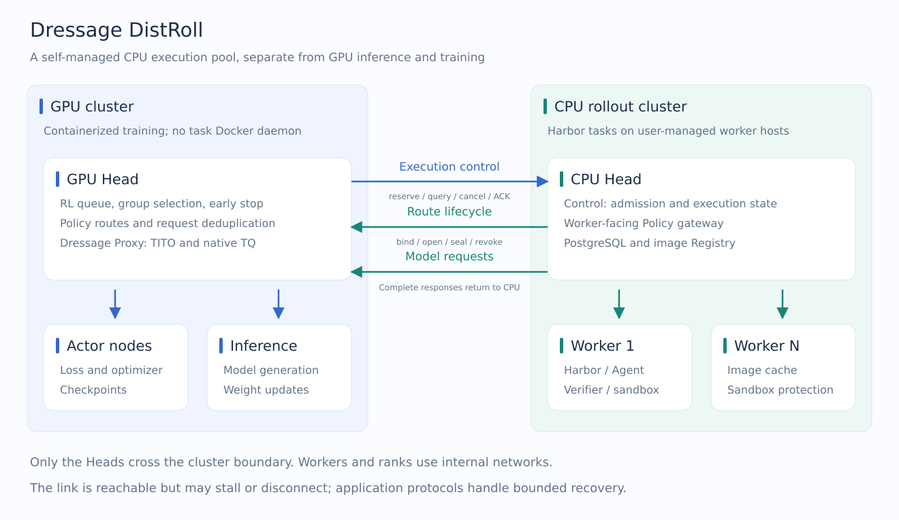
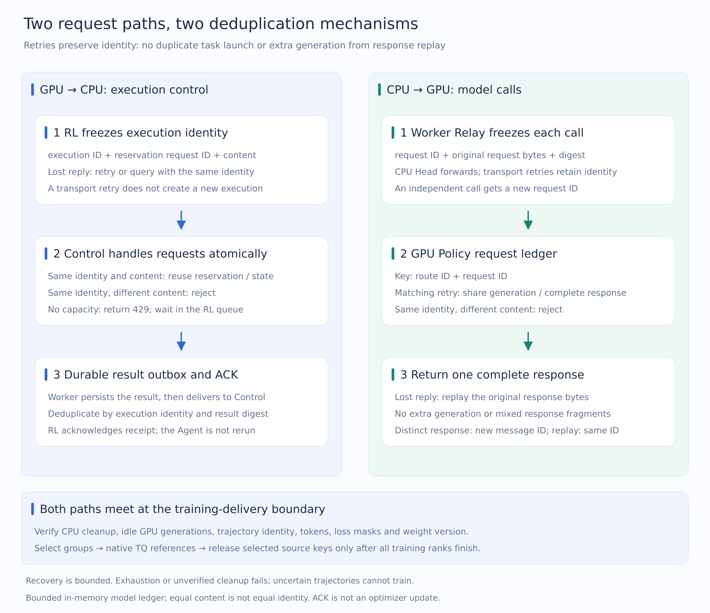
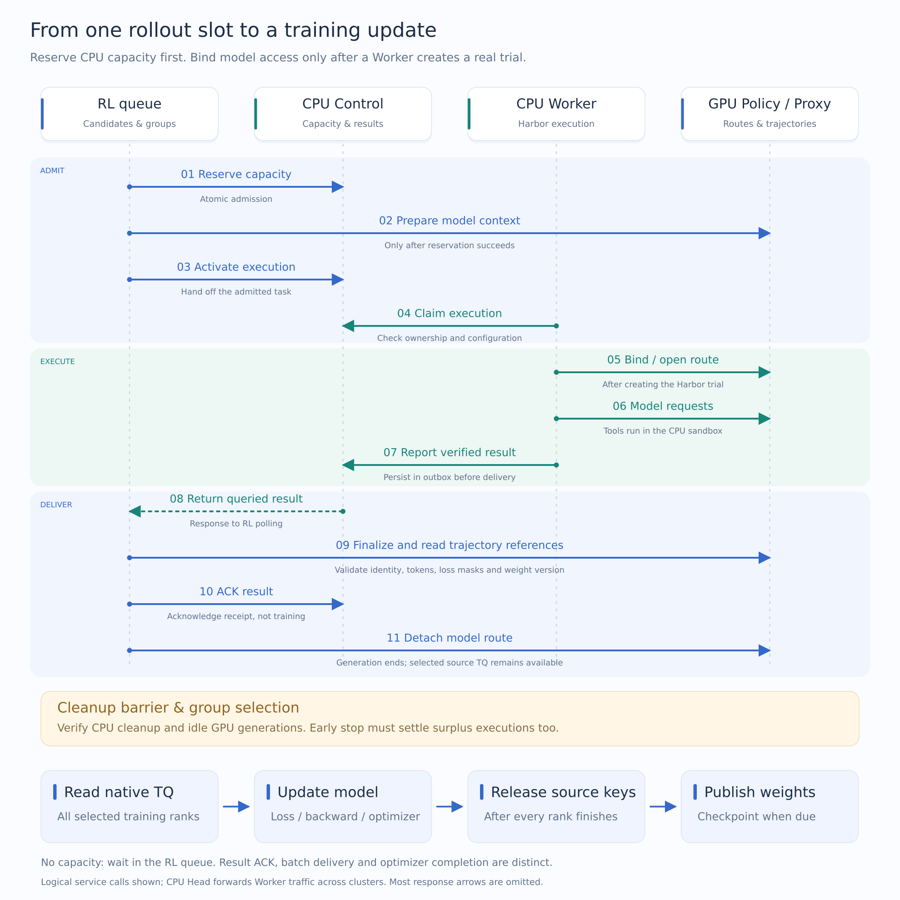
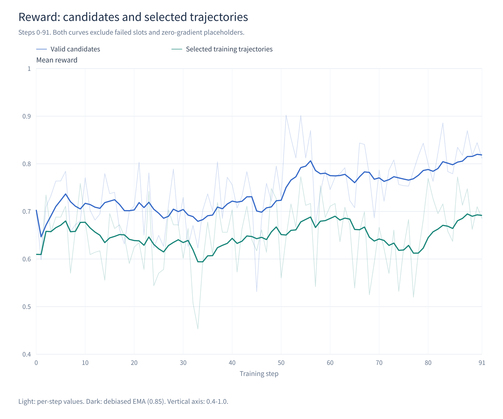
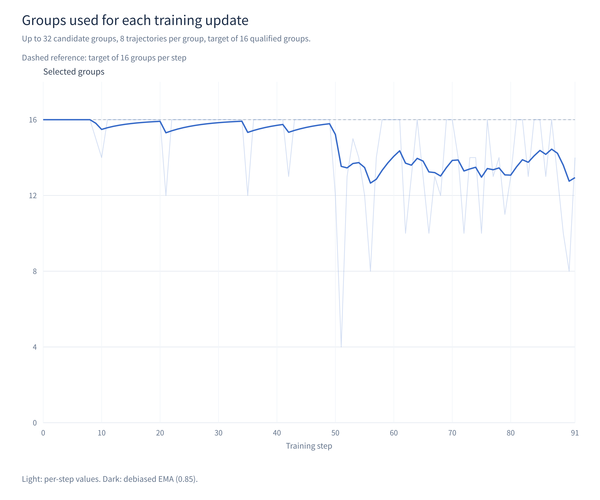

# Dressage DistRoll: Agentic RL with an independent CPU execution pool

  <strong>Jingtao Jiang1,2 · Zhiyong Tan1,3 · Zhao Shan1,* · Yuyao Zhang1 · Yujia Xiao1</strong>

  1 中移九天人工智能有限公司 (China Mobile Jiutian AI) 
  2 Tsinghua University &nbsp;&nbsp; 3 Peking University

  Jingtao Jiang and Zhiyong Tan are students at Tsinghua University and Peking University, respectively, 
  and interns at China Mobile Jiutian AI. 
  * Project supervision: Zhao Shan

[中文](PROJECT.zh-CN.md) · [Training runbook](TRAINING.md) · [Dependencies](DEPENDENCIES.md)

Agentic RL asks an agent to complete real work in a sandbox: change code, install
dependencies, run tools and submit the result to a verifier. These tasks depend on
operating-system permissions, disk space and external connectivity as well as compute.

A GPU training environment is not always a good place to run them. Containerized
GPU jobs may lack permission to start Docker sandboxes. Restricted or slow egress
can also stall concurrent dependency downloads. Running tasks on CPU servers with
suitable connectivity lets the GPU cluster concentrate on inference and training.

Dressage already supports remote sandboxes through E2B. DistRoll serves users who
want to manage their own CPU servers: a CPU Head coordinates Workers, capacity,
Harbor execution, result delivery and image caching. It reuses Dressage's trajectory
and training interfaces and supplies the services needed by that execution pool.

All example-specific code lives in `examples/harbor/distroll/`. The three Python
packages are installed separately. GPU nodes use the contract and GPU adapter;
CPU nodes use the contract and rollout service, without Dressage, Ray or Torch.

## Design

### Two Heads connect two resource pools

The GPU side owns candidate queues, GRPO group selection, inference and parameter
updates. The CPU side owns individual task executions. An execution, also called
an attempt, creates a Harbor trial. Retrying a task creates a new execution identity.

Only the GPU Head and CPU Head communicate across clusters. CPU Workers and GPU
ranks use their respective internal networks. The link must be reachable but may
stall or disconnect; its physical construction is outside this example's scope.

| Direction | Requests | Responsibility |
| --- | --- | --- |
| GPU Head → CPU Head | reserve, activate, query, cancel, ACK | Admit an execution, retrieve its result and acknowledge receipt |
| CPU Head → GPU Head | bind, open, seal, revoke | Open model access for a real trial, then finalize or discard its trajectory |
| CPU Head → GPU Head | Agent model calls | Return complete generated responses; training tokens and logprobs stay on the GPU side |

Policy manages model routes and the request ledger; Dressage Proxy adapts the
model protocol and records training trajectories. CPU Control manages executions
and capacity. The Head gateway forwards Worker model and lifecycle requests, so
adding a Worker does not require another cross-cluster GPU connection.

Candidates wait in the RL queue. A GPU model context is prepared only after an
atomic capacity reservation succeeds. The model route is bound after a Worker
claims the execution and creates its real trial. Capacity pressure leaves work
queued on the RL side without creating idle model routes. See
[execution.py](../gpu_adapter/src/dressage_distroll_gpu_adapter/execution.py) and
[store.py](../rollout_service/src/rollout_service/store.py).

### Preserve business identity across transport failures

Execution control and model calls use the same cross-cluster link, but have
separate ledgers for deduplication. The diagram places their logical flows side
by side. Transport retries retain the original identity; rerunning a failed
attempt creates another execution and is not response replay.

Arrows show business stages, not network infrastructure. Worker-to-Control outbox
delivery stays inside the CPU cluster. Both paths lead to the training-delivery
checks: result receipt, resource cleanup and training consumption are distinct
boundaries and cannot substitute for one another.

A submission timeout may mean either that a request never arrived or that the
server executed it and the reply was lost. Control uses stable execution identity,
content digests and database transactions to distinguish retries from conflicts.
A Worker persists a completed result in its outbox before delivery. Resending a
result does not rerun the Agent. An RL acknowledgement confirms receipt and handling,
not completion of an optimizer update.

Example: a reservation succeeds, but its reply is lost

> RL submits execution `E17`. Control reserves capacity, but the response is lost.
> RL retries with the same identity and content. Control returns that reservation
> without charging capacity twice. Reusing `E17` for different task content is
> rejected. Result delivery and acknowledgements also reuse stable identities.

Model calls have their own request identities. A Worker-local Relay freezes the
request ID, bytes and digest. Retries preserve all three. GPU Policy shares an
in-flight generation or returns its cached complete response. Replaying that
response does not record a second generation in Proxy. See
[policy_relay.py](../rollout_service/src/rollout_service/policy_relay.py) and
[policy_service.py](../gpu_adapter/src/dressage_distroll_gpu_adapter/policy_service.py).

Example: generation finishes, but the response is interrupted

> Request `Q5` on route `E17` has generated a tool call, but the CPU receives only
> part of the response. Relay retries `E17/Q5` with the original content. Policy
> returns the complete result of that generation. It neither samples again nor
> joins fragments from two different generations.

Independent responses have distinct message IDs; replay preserves the original
ID and bytes. Deduplication follows request identity, not content equality.

Example: identical content in two independent calls

> The Agent independently issues `Q5` and `Q6`. Even if their contents match, both
> calls generate a response, identified by `M5` and `M6`. A retry caused only by
> losing the response to `Q5` still returns `M5`. Request IDs identify retries;
> message IDs identify responses.

These guarantees require a valid ledger and a bounded recovery budget. Prolonged
outages, lost process state, identity conflicts or unverified cleanup cause an
explicit failure. The system does not promise unlimited recovery or absolute
exactly-once execution. Transport retries and retries of failed attempts are
separate settings.

### Harbor runs tasks; Workers manage resources

Harbor creates the sandbox, prepares and runs the Agent, executes the verifier,
and cleans up the environment. DistRoll adds scheduling, model access, resource
protection and reliable delivery around that lifecycle. Tasks retain Harbor's
instructions, environment and verification format. Image digests are frozen before
training; runtime execution does not build images or reinstall Claude. See
[harbor_runner.py](../rollout_service/src/rollout_service/harbor_runner.py).

Each Worker declares CPU scheduling units and a memory budget in its inventory.
The resource index specifies each task's charge. Control admits work only to a
healthy Worker with enough of both resources and prefers lower relative load.
Virtual capacity controls admission while Docker enforces sandbox limits. It
does not create physical memory and must reflect task working sets and peaks.

A persistent Registry stores task images. Workers pull them on demand and keep
hot caches instead of storing the full task collection in every Docker root.
Cleaner is the per-Worker image-reclamation process. Tasks hold image-use locks;
Cleaner obtains exclusive access, checks for container references and reclaims
managed images according to idle age and disk watermarks. Docker retains shared
layers while other images reference them. See
[image_cache.py](../rollout_service/src/rollout_service/image_cache.py) and
[image_cleaner.py](../rollout_service/src/rollout_service/image_cleaner.py).

Guard is the Worker's local sandbox resource monitor. In enforce mode, repeated
OOM kills together with sustained memory pressure trigger stop-loss cleanup.
It blocks further sandbox creation for that execution, requests cancellation and,
when needed, force-stops its exact containers before verifying resource removal.
Local cleanup does not wait for the cross-cluster link; releasing Control's
capacity charge still requires cleanup evidence.

Normal cancellation and resource stop-loss share the execution cleanup path.
If removal cannot be verified, the Worker is quarantined and its charge remains.
Protection applies to an execution, not a permanent task ban. See
[worker.py](../rollout_service/src/rollout_service/worker.py) and
[sandbox_guard.py](../rollout_service/src/rollout_service/sandbox_guard.py).

### Synchronous training and the TQ lifecycle

A prompt group contains multiple logical sampling slots. Default collection
finishes the candidate budget, selects complete groups first, and fills remaining
positions with partial groups that meet the success quorum, have nonzero reward
variance among successful trajectories and contain at least one positive reward.
Failed slots are zero-gradient placeholders, not valid negative examples with
reward zero. Fewer qualified groups produce a smaller update; zero groups stop.

With explicit early stop, reaching the target number of qualified groups stops
dispatch and cancels surplus work. CPU cleanup and old GPU generations must finish
before updating weights. Completion-order selection can introduce speed bias.
See [rollout.py](../gpu_adapter/src/dressage_distroll_gpu_adapter/rollout.py).

TITO organizes trajectories from actual input and generated token IDs. Compaction
or history changes may create multiple segments, which still belong to one
trajectory. Reused history is zero-gradient context, and reward/advantage handling
preserves the parent trajectory relationship.

A successful execution uses detach to close its route: generation stops while
source TQ references remain valid. Unselected references are released after group
selection. Training ranks hydrate selected references into real logprobs, compute
loss, run backward and finish the optimizer before source keys are released.
All ranks must pass the hydration and numeric checks; a failed reader cannot leave
other ranks updating independently. See
[native_tq_actor.py](../gpu_adapter/src/dressage_distroll_gpu_adapter/native_tq_actor.py)
and [persistent_train.py](../gpu_adapter/src/dressage_distroll_gpu_adapter/persistent_train.py).

Regular training does not back up complete trajectories. It retains control
metadata, CPU task artifacts and training logs. After process-level failure,
resume from a complete model checkpoint and redo the affected batch.

## Experimental observations

The following measurements come from the running implementation before this
example's source-layout migration: 92 completed Qwen3.5-9B updates on 1500 TMAX
tasks, indexed 0–91. Duplicate updates across checkpoint recovery were excluded;
only completed optimizer updates on the retained training lineage were counted.
**These historical results do not validate the migrated example or its new fixed
execution deadlines.**

| Item | Setting |
| --- | --- |
| GPU resources | Three nodes, eight devices each; two for training, one for inference |
| CPU resources | Two cloud hosts, each with 16 CPU cores, 64 GB RAM and 500 GB disk |
| Training | Synchronous GRPO, TITO and native TQ; TP4 × CP2 × PP1 × DP2 |
| Sampling | Target 16 × 8; 32 candidate groups; concurrency 128; full groups first, quorum 6/8; early stop off |
| Agent | Claude Code 2.1.207; 40 turns / 1200 s; explicit max-turns completion proceeds to verification |
| Context | 65472 tokens; response 8192; autocompact 80%; Read output limit 1024 |
| Optimization | LR 1e-6, constant; TIS; clipping 0.2/0.28; KL and entropy coefficients zero; no second advantage normalization |
| Checkpoints | Every 10 steps and the normal final step; at most five per run; no separate evaluation schedule |

Blue is mean reward over valid candidate trajectories; green is mean reward over
valid trajectories selected for training. Both exclude failed slots and
zero-gradient placeholders. Light curves show per-step values; dark curves use
debiased EMA with weight 0.85. The vertical axis starts at 0.4.

Averaging the per-step values, the first ten and last ten updates have candidate
rewards of 70.7% and 82.7%, and selected-trajectory rewards of 66.9% and 70.0%.
The selected curve uses TensorBoard's `rollout/raw_reward_trajectory_mean`.
Candidate rewards come from the matching valid-trajectory control records, with
selected rewards cross-checked against TensorBoard.

The mean selected batch contains 14.58 groups, ranging from 4 to 16. The first ten
updates average 15.90 groups and the last ten average 13.50. Multiple segments of
one trajectory do not count as independent samples.

These are training-workload observations, not evidence of improvement on a fixed
held-out evaluation. Task difficulty, completion rates and selection affect the
denominators. No matched E2B cost or performance comparison was run. De-identified
per-step values and figure-rendering code accompany the plots; raw task traces
and operational logs are not included.

## Limitations and future work

Model traffic between the Heads becomes a material scaling constraint. For the
observed task mix, roughly 30 Mbps of sustained effective bandwidth is a planning
starting point for concurrency in the hundreds. Larger workloads may require
hundreds of Mbps or Gbps links. Request size, call frequency and retry bursts must
be measured at the intended load; concurrency alone does not determine bandwidth.

This example supports synchronous training. Adapting Dressage's asynchronous or
fully asynchronous workflows requires RL-side handling of staleness, weight
transitions, pause/resume and TQ consumption timing. CPU services continue to own
individual executions rather than training orchestration.

A self-managed pool also requires maintaining the database, Workers, Registry
and network. DistRoll supplies an explicit implementation of those controls;
users whose E2B path already meets their needs do not need to replace it.
