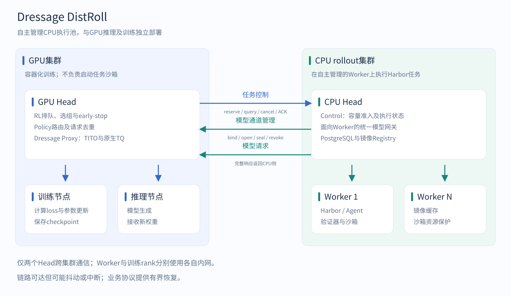
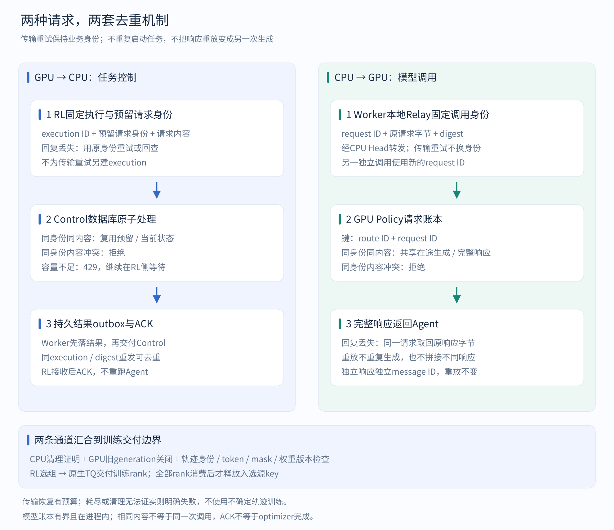
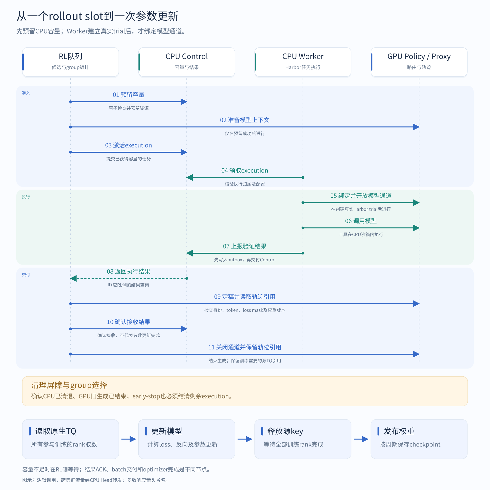
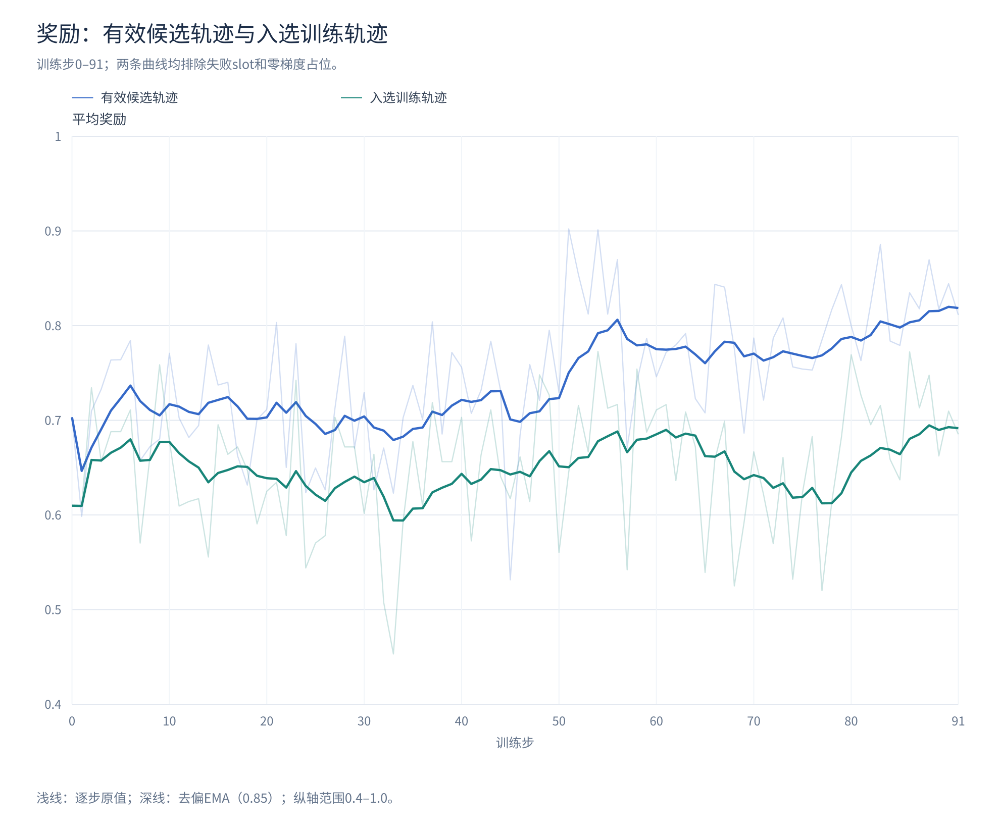
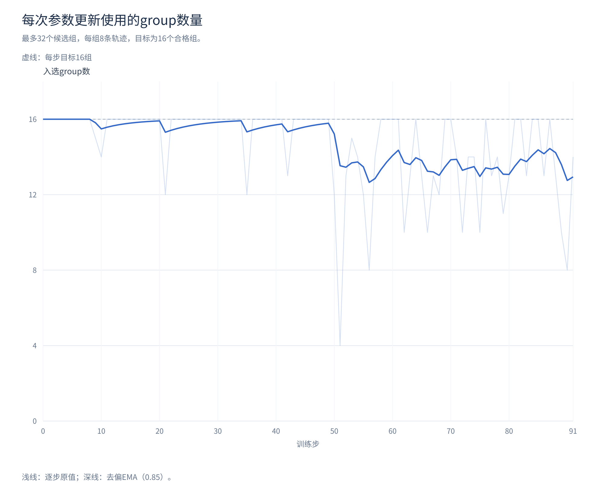

# Dressage DistRoll：独立CPU执行池上的Agentic RL

  <strong>江静涛1,2 · 谭智勇1,3 · 单昭1,* · 张禹尧1 · 肖羽佳1</strong>

  1 中移九天人工智能有限公司 
  2 清华大学 &nbsp;&nbsp; 3 北京大学

  江静涛、谭智勇分别为清华大学、北京大学在校学生，并在中移九天人工智能有限公司实习。 
  * 项目指导：单昭

[English](PROJECT.md) · [运行手册](TRAINING.md) · [依赖说明](DEPENDENCIES.md)

Agentic RL需要让Agent在沙箱里完成真实任务：修改代码、安装依赖、调用工具，再由Verifier验证结果。这些工作不仅消耗计算资源，也依赖操作系统权限、磁盘空间和外网访问条件。

GPU训练环境往往不适合同时承担这些职责。一些集群通过容器提供算力，不方便在训练容器内再启动Docker；另一些集群的外网连接难以支持大量沙箱并发下载。把任务执行放到具备合适联网条件的CPU服务器上，可以让GPU集群专注于推理和训练。

Dressage已经支持E2B远程沙箱。DistRoll面向希望使用自有CPU服务器的用户：用一个CPU Head协调多个Worker，管理任务容量、Harbor执行、结果交付和镜像缓存。它复用Dressage的轨迹与训练接口，新增自建执行池所需的服务和运行方法。

全部专属代码位于`examples/harbor/distroll/`，三个Python包分别安装。GPU侧使用contract和gpu_adapter；CPU侧使用contract和rollout_service，无需安装Dressage、Ray或Torch。

## 设计原理

### 两个Head连接两个资源池

GPU侧负责候选排队、GRPO组选择、模型推理和参数更新。CPU侧负责单次任务执行。一次实际执行称为execution或attempt；Harbor创建的运行实例称为trial。任务重新尝试会获得新的execution身份。

只有GPU Head与CPU Head需要跨集群通信。CPU Worker和GPU训练、推理节点分别使用自己的内网。两个Head之间只要求链路可达；链路可能抖动或中断，连接的具体搭建方式不属于本示例。

| 方向 | 请求 | 作用 |
| --- | --- | --- |
| GPU Head → CPU Head | reserve、activate、查询、cancel、ACK | 预留容量、提交execution、取回结果并确认接收 |
| CPU Head → GPU Head | bind、open、seal、revoke | 为真实trial开放模型访问，结束时封存或清理轨迹 |
| CPU Head → GPU Head | Agent模型调用 | 获取完整生成响应；训练token和logprob保留在GPU侧 |

GPU端的Policy管理模型通道及请求账本，Dressage Proxy处理模型协议并记录训练轨迹。CPU端的Control管理execution与资源账本，Head gateway汇总Worker发出的模型和生命周期请求。扩容Worker不需要GPU逐台建立连接。

RL先在本地排队；Control原子预留成功后，才准备GPU模型上下文。Worker领取execution、建立真实trial后，再绑定route。容量不足时继续在RL侧等待，不为排队任务提前占用模型通道。实现见[execution.py](../gpu_adapter/src/dressage_distroll_gpu_adapter/execution.py)和[store.py](../rollout_service/src/rollout_service/store.py)。

### 传输失败时维持同一次业务身份

任务控制与模型调用经过同一条跨集群链路，但分别用执行账本和模型请求账本处理重复请求。下图将两条逻辑流程并列展示：传输重试沿用原身份，重新执行失败attempt则是另一条execution，不属于图中的响应重放。

图中箭头表示业务阶段，不是具体网络设施；Worker向Control交付outbox结果发生在CPU集群内部。两条流程最终都受训练交付检查约束：结果接收、资源清理和训练消费是不同节点，不能互相替代。

任务提交超时，既可能是请求没送到，也可能是服务已经执行、回复却丢了。Control通过稳定execution身份、内容摘要和数据库事务区分重复请求与冲突请求。Worker完成任务后，先把结果持久写入outbox——等待交付的结果发件箱——再向Control上报。结果重发不会重新运行Agent；RL的ACK表示已经接收处理结果，不代表optimizer已经执行。

例子：预留已经成功，回复丢失

> RL为任务生成execution `E17`。Control已经为它预留资源，但回复在途中丢失。RL继续使用`E17`和原请求内容重试，Control返回同一条预留，不再扣除第二份容量。若相同身份带来了不同任务内容，Control拒绝请求。任务完成后的结果和ACK同样按稳定身份重放。

模型调用使用独立的请求身份。Worker本地Relay为一次调用确定request ID，固定请求字节和摘要；传输重试保持它们不变。GPU Policy复用该请求正在进行的生成，或返回已缓存的完整响应。完整响应返回Agent后，网络重放不会给Proxy增加第二次生成记录。实现见[policy_relay.py](../rollout_service/src/rollout_service/policy_relay.py)和[policy_service.py](../gpu_adapter/src/dressage_distroll_gpu_adapter/policy_service.py)。

例子：模型生成完成，返回途中断线

> route `E17`上的请求`Q5`已经生成一个工具调用，但CPU没有收到完整响应。Relay重发的仍是`E17/Q5`及原始内容。Policy返回同一次生成的完整结果，不重新采样，也不拼接两次生成的残片。

独立模型响应具有独立message ID；同一响应重放保留原ID和字节。这里按请求身份去重，不能把内容相同的两次独立调用合并。

例子：相同内容的两次调用

> Agent独立发起`Q5`与`Q6`，即使请求内容完全一样，也各自推理并获得`M5`与`M6`两条消息。如果只是`Q5`的响应丢失，重放的仍是`M5`。请求身份用于识别重试，消息身份用于标识响应。

这些保证依赖有效账本和有限恢复预算。长期中断、进程状态丢失、身份冲突或清理无法确认时，系统明确失败，不承诺无限恢复或绝对exactly-once。传输重试和重新运行失败attempt是两个独立配置。

### Harbor执行任务，Worker管理资源

Harbor负责创建沙箱、准备Agent、执行工具、运行Verifier及清理环境。DistRoll在外围补充调度、模型访问和可靠交付。任务沿用Harbor的指令、环境与验证格式；预构建镜像在训练前固定digest，运行中不build/push或重新安装Claude。入口见[harbor_runner.py](../rollout_service/src/rollout_service/harbor_runner.py)。

每个Worker在inventory中声明CPU调度额度和内存预算，任务通过resource index声明消耗。Control只选择健康且两项余额都足够的Worker，并优先分配到相对负载较低的节点。虚拟容量用于调度，Docker限额负责实际隔离；它不增加物理内存，必须依据任务工作集和峰值设置。

任务镜像保存在持久Registry中。Worker按需拉取、复用热缓存，无需在本地Docker root常驻全量镜像。Cleaner是每个Worker的镜像清理器：任务持有镜像使用锁，Cleaner取得排他锁、确认没有容器引用后，按闲置时间和磁盘水位回收项目管理的缓存。公共layer由Docker按引用关系保留。实现见[image_cache.py](../rollout_service/src/rollout_service/image_cache.py)和[image_cleaner.py](../rollout_service/src/rollout_service/image_cleaner.py)。

Guard是Worker本地的单sandbox保护器，读取cgroup资源统计。enforce模式下，反复OOM kill同时伴随持续内存压力时触发止损：阻止继续创建该execution的沙箱，取消任务，必要时强制终止其精确容器，再核验资源消失。清理不等待跨集群网络恢复；向Control释放账本仍必须提供清理证明。

正常取消与资源异常共用execution清退流程。不能证明资源消失时，Worker隔离并保留账本占用。保护针对execution，不永久封禁task；同一任务以后重新提交仍可调度。见[worker.py](../rollout_service/src/rollout_service/worker.py)及[sandbox_guard.py](../rollout_service/src/rollout_service/sandbox_guard.py)。

### 同步训练与TQ生命周期

一个prompt group包含同题的多个逻辑slot。默认模式完成候选预算后，优先选择完整组，再以达到成功率门槛、成功轨迹reward有差异且至少一条为正的部分组补足。失败slot仅作零梯度占位，不作为reward为0的有效负样本。合格组不足目标时使用较小batch；零合格组停止。

显式开启early-stop后，凑够目标合格组即停止派发并取消其余候选。CPU清退和GPU旧生成活动都必须结束，才允许参数更新。这个策略按完成顺序选组，可能引入速度偏差。组编排与选择见[rollout.py](../gpu_adapter/src/dressage_distroll_gpu_adapter/rollout.py)。

TITO按真实输入与生成token组织轨迹。历史压缩或改写可能产生多个segment，但这些segment仍属于同一条trajectory。复用的历史只作为零梯度上下文，reward与advantage按原始trajectory关系传播。

成功execution关闭route时使用detach：停止后续生成，但保留源TQ引用。未入选引用在选组后释放；入选引用由训练rank读取真实logprob，完成loss、反向与optimizer后再统一释放。各rank还要通过数值及读取成功屏障，不能让部分rank读取失败而其他rank继续更新。见[native_tq_actor.py](../gpu_adapter/src/dressage_distroll_gpu_adapter/native_tq_actor.py)和[persistent_train.py](../gpu_adapter/src/dressage_distroll_gpu_adapter/persistent_train.py)。

日常训练不备份完整轨迹。必要控制状态、CPU原始任务产物和训练日志保留；进程级故障后，从完整模型checkpoint恢复，并重做受影响批次。

## 实验结果

以下是示例迁移前运行版本的观测结果：Qwen3.5-9B在TMAX 1500条任务上完成的92个训练更新，step为0–91。跨checkpoint恢复的重复更新已去重，只计完成optimizer的主线。**当前示例的路径迁移与固定execution截止时间不由这组历史结果验收。**

| 项目 | 设置 |
| --- | --- |
| GPU资源 | 三个节点，各8张设备；两节点训练，一节点推理 |
| CPU资源 | 两台云主机，各16核、64GB内存、500GB磁盘 |
| 训练 | 同步GRPO，TITO与原生TQ；TP4×CP2×PP1×DP2 |
| 采样 | 目标16组×8；32候选；全局128并发；完整组优先，6/8 quorum；early-stop关闭 |
| Agent | Claude Code 2.1.207，40轮/1200秒；明确max-turns结束后继续verify |
| 上下文 | 65472；单次响应8192；autocompact80%；Read输出1024 |
| 优化 | LR1e-6，constant；TIS；clip0.2/0.28；KL及entropy系数0；不做二次advantage归一化 |
| 保存 | 每10步及正常末步保存；每run最多5份checkpoint；未设置独立evaluation |

蓝线是有效候选trajectory的平均reward，绿线是入选训练的有效trajectory，两者排除失败slot和零梯度占位。浅线为逐步原值，深线为去偏EMA，平滑权重0.85；纵轴从0.4开始。

对逐step值取平均，最初10步到最后10步，有效候选reward从70.7%变为82.7%，入选trajectory从66.9%变为70.0%。入选曲线来自TensorBoard的`rollout/raw_reward_trajectory_mean`；候选曲线由对应控制记录中的有效轨迹奖励计算，并核对了入选奖励的一致性。

平均每步入选14.58组，范围4–16组；最初10步平均15.90组，最后10步13.50组。一个trajectory的多个segment只计作一次采样。

这些结果反映训练集rollout的变化，不是固定评测集上的能力提升证明。候选难度、成功完成率和选组机制都会改变统计分母；也没有与E2B做相同条件的成本或性能对照。图表使用去标识的逐步数值，随文提供数据和渲染脚本，不包含原始任务轨迹或运行日志。

## 局限与后续工作

两个Head之间的模型流量是扩容时的重要约束。按当前任务负载，百级并发可把持续有效带宽约30Mbps作为规划起点；更大并发可能需要百兆或千兆级链路。实际需求取决于请求体大小、调用频率及突发重传，必须以目标负载测量，不能仅按任务数推算。

当前示例支持同步训练。后续若接入Dressage的异步、纯异步流程，需要在RL侧处理样本陈旧度、权重切换、暂停恢复和TQ消费时机。CPU服务继续管理单execution，不接管训练编排。

自建执行池同时意味着维护数据库、Worker、镜像仓库和网络。DistRoll提供这些环节的可控实现；已有E2B路径满足需求时，无需为使用本示例而更换后端。
